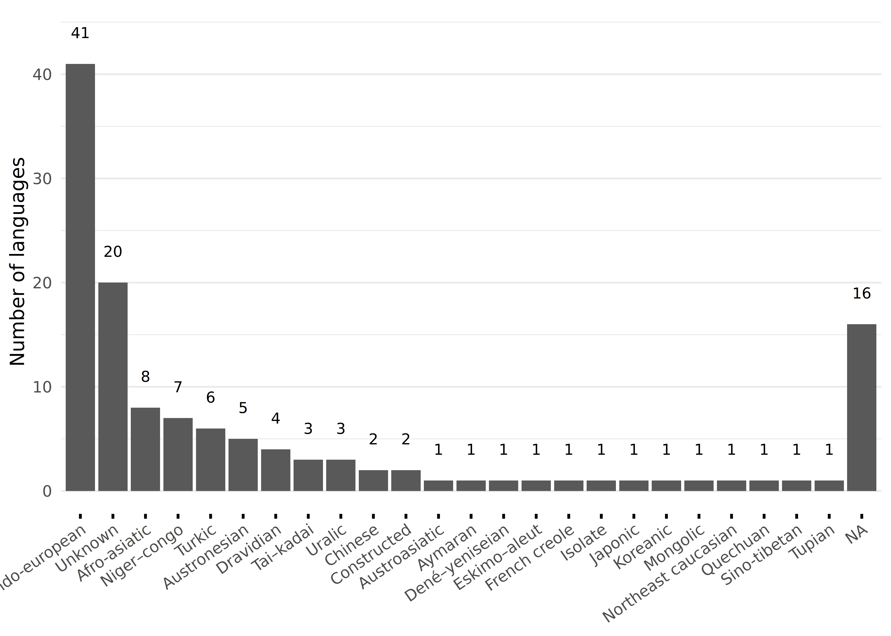

```{r}
# | label: setup
library(readr)
library(here)

set_here("..")

raw <- read_csv(here("out", "pronunciations.csv"), show_col_types = FALSE)
dat <- read_csv(here("out", "ssp.csv"), show_col_types = FALSE)

```

## Datasets




## References

